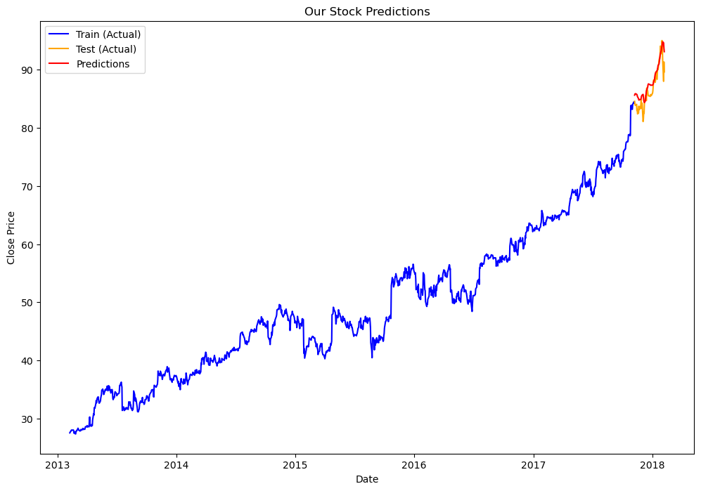
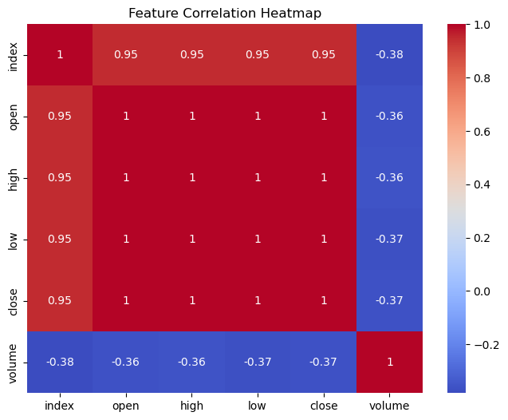

# 📈 Stock Price Forecasting with LSTM

> A deep learning model that reads the last 60 trading days of Microsoft's stock and predicts the next day's closing price.



<sub>Blue: training history. Orange: actual test-period prices. Red: model predictions.</sub>

---

## 💡 Why this project

Financial prices are a classic hard time-series problem: noisy, trending and non-stationary. LSTMs (Long Short-Term Memory networks) are designed to remember patterns across long sequences, which makes them a natural first deep learning approach. This project builds the full workflow: exploration, windowing, modeling and evaluation.

## 📊 At a glance

| | |
|---|---|
| Data | **1,259 trading days** of MSFT prices (Feb 2013 to Feb 2018) |
| Input | Previous **60 days** of closing prices (sliding window) |
| Model | 2 × LSTM(64) → Dense(128, ReLU) → Dropout(0.5) → Dense(1) |
| Size | **58,369 parameters** |
| Split | First 95% train, final 5% test (chronological) |
| Training | 20 epochs, Adam optimizer, MAE loss, RMSE tracked |

On the unseen test period the predictions follow the actual upward trend and its turning points closely (see chart above).

## 🔧 How it works

1. **Explore**: plotted open/close prices and volume over time and checked feature correlations.

   

2. **Scale**: standardized closing prices so the network trains stably.
3. **Window**: turned the series into supervised examples: 60 days in → next day out.
4. **Model**: two stacked LSTM layers learn temporal patterns, and dropout reduces overfitting.
5. **Predict & invert**: predictions are scaled back to dollar prices and plotted against reality.

## 🚀 Quick start

```bash
pip install tensorflow pandas numpy scikit-learn matplotlib seaborn
jupyter notebook "LSTM STOCK Exchange.ipynb"
```

`MicrosoftStock.csv` is included. Point the `pd.read_csv(...)` call in the third cell at it.

## 🧰 Tech stack

Python · TensorFlow / Keras · scikit-learn · pandas · NumPy · Matplotlib · Seaborn

## 🔭 What I'd do next

- Report test RMSE and MAPE, and compare against a naive "tomorrow = today" baseline
- Fit the scaler on training data only to remove any look-ahead
- Add volume and technical indicators (moving averages, RSI) as extra inputs
- Try GRU and Transformer models, and forecast several days ahead

## ⚠️ Disclaimer

Educational project only. Not financial advice.

---

<sub>Built by [Shweta Smriti Tripathi](https://www.linkedin.com/in/shweta-smriti-tripathi/)</sub>
